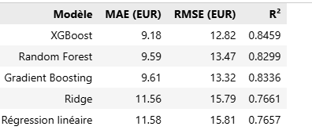

# Projet Getaround - Analyse des retards et optimisation du prix


---
## Démos en ligne

| Service | URL | Description |
|---|---|---|
| **API de prédiction** | https://getaround-fastapi-770512542898.europe-west9.run.app | Endpoint `/predict` pour suggérer un prix journalier |
| Documentation API | https://getaround-fastapi-770512542898.europe-west9.run.app/docs | Page HTML interactive avec exemples et schémas |
| **Tableau de bord** | https://getaround-dashboard-770512542898.europe-west9.run.app/ | Analyse interactive des retards avec simulateur de seuil |


## Présentation

Ce projet répond à une double problématique pour la plateforme de location de véhicules entre particuliers Getaround :

1. **Analyse des retards** : étudier l'impact des retours tardifs entre deux locations consécutives, et calibrer un seuil minimum de délai entre deux locations afin de réduire les frictions clients sans pénaliser les revenus des propriétaires.
2. **Optimisation du prix** : construire un modèle de Machine Learning qui suggère le prix journalier optimal d'une location à partir des caractéristiques du véhicule, et l'exposer via une API documentée.

## Structure du dépôt

```
getaround_project/
├── api/                          # API FastAPI de prédiction
│   ├── app.py                    # Code de l'API
│   ├── Dockerfile                # Image
│   └── requirements.txt          # Dépendances
├── dashboard/                    # Tableau de bord Streamlit
│   ├── dashboard.py              # Application Streamlit
│   ├── data/                     # Données de retards (xlsx)
│   ├── Dockerfile                # Image
│   └── requirements.txt          # Dépendances
├── data/                         # Données sources
│   ├── get_around_delay_analysis.xlsx
│   └── get_around_pricing_project.csv
├── notebooks/                    # Notebook d'analyse complète
│   └── analyse_getaround.ipynb
├── train_model.py                # Script d'entraînement réutilisable
└── README.md
```

## Résultats principaux

### Analyse des retards

| Indicateur | Valeur |
|---|---|
| Locations totales analysées | 21 310 |
| Taux d'annulation | 15,3% |
| Restitutions en retard | 57,5% |
| Délai médian au checkout | +9 min |
| Locations chaînées | 8,6% (1 841) |
| Cas problématiques (attente subie) | 12,6% des chaînages |

**Recommandation principale** : un seuil entre **90 et 120 minutes** appliqué à l'ensemble du parc résout 83% des cas problématiques. Une approche prudente alternative consiste à appliquer 60 minutes uniquement aux voitures Connect.

### Modèle de pricing



Le modèle retenu est un XGBoost Regressor avec une MAE de 9,18 EUR sur le jeu de test, suffisamment précis pour suggérer un prix de référence aux propriétaires.

## Déploiement en production

Les deux composants (API et dashboard) sont conteneurisés et déployés sur GCP Cloud RUN (voir la section "Démos en ligne" en haut de ce document).

### API
- `URL/docs` - documentation HTML
- `URL/redoc` - documentation OpenAPI alternative

Endpoints accessibles :
- `GET /` - accueil
- `GET /health` - état du service
- `POST /predict` - prédiction du prix

## Dépendances principales

- Python >= 3.12
- pandas, numpy, scikit-learn 1.8, xgboost 3.2
- mlflow pour le suivi d'expériences
- FastAPI + Uvicorn pour l'API
- Streamlit + Plotly pour le dashboard

## Licence

Projet pédagogique. Données fournies par Getaround.


